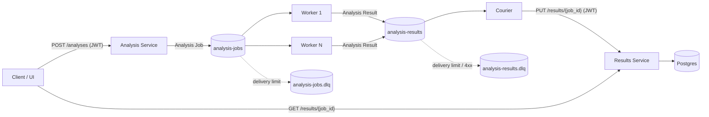

# Demo runbook

A live technical walkthrough of about 10 minutes. Every command is meant to be
copied and pasted from the repo root. Nothing builds during the demo.

## Prep (before the audience arrives, ~10 min)

1. Use the e2e overlay in this shell, so the `images` nginx exists and every
   `docker compose` command below sees it:

   ```bash
   export COMPOSE_FILE=compose.yaml:compose.e2e.yaml
   ```

2. Free RAM: stop other compose stacks (`docker compose ls`) and heavy apps.
   On a starved host, image fetches pass the Worker's 10 s limit and the
   burst ends with `image_unreachable` Results.

3. First time only: create `.env` with a key pair.

   ```bash
   cp .env.example .env && uv run generate-keys
   ```

4. Pull and build the images, then start the stack:

   ```bash
   docker compose pull --ignore-buildable
   docker compose build
   docker compose up -d --wait
   ```

5. Mint a client token and keep it in the shell:

   ```bash
   TOKEN=$(docker compose exec -T courier issue-token --sub demo)
   ```

6. Open three browser tabs:
   - UI: <http://localhost:8001>. Paste `$TOKEN` (`echo $TOKEN`) into
     **Client token**.
   - Management UI: <http://localhost:15672> (user and password from `.env`,
     `people-counter` by default) → **Queues and Streams**.
   - This runbook.

7. Open a second terminal in the repo root and run
   `export COMPOSE_FILE=compose.yaml:compose.e2e.yaml` there too. It shows logs.

> Known issue: Wikimedia answers `403` to the Worker's default
> `python-httpx` User-Agent, so section 2 (Happy path) ends as an
> `image_unreachable` Result until the Worker sends a descriptive User-Agent
> (build ticket 12). Until then, show the happy path with
> `http://images/tennis-group.jpg` (the Result lands, but the browser can't
> load the image to draw the boxes).

## 1. Architecture (~1 min)



Talking points:

- The API only publishes and answers `202` with a `result_url`. It never waits
  for the analysis.
- Both queues are quorum queues with delayed retry and a delivery limit. After
  the limit, a message goes to its `.dlq`.
- The Courier is the only writer to the Results Service. A Results outage
  never loses a Result: it waits in `analysis-results`.

## 2. Happy path in the UI (~1.5 min)

1. In the UI tab, paste this into **Image URL** and submit:

   ```text
   https://upload.wikimedia.org/wikipedia/commons/3/30/Pedestrians_on_Charles_Bridge.jpg
   ```

   Backup photo:

   ```text
   https://upload.wikimedia.org/wikipedia/commons/f/f7/People_walking_on_a_street_in_Copenhagen.jpg
   ```

2. The page shows the `job_id`, then the Result appears in the table.
3. Click the Result: the photo is drawn with a box per detected person.

## 3. Load burst and scaling (~3 min)

1. Second terminal: follow the Workers.

   ```bash
   docker compose logs -f worker
   ```

2. First terminal: send 200 jobs.

   ```bash
   uv run scripts/demo_load.py --token "$TOKEN"
   ```

   It prints the status counts, for example `200 x 202`.
3. Management UI: `analysis-jobs` **Ready** climbs (its numbers lag about
   5 s). In the logs each line is prefixed by its replica (`worker-1`,
   `worker-2`) and shows `job_id`, `person_count` and `duration_ms`.
4. While the queue is still deep, scale out:

   ```bash
   docker compose up -d --scale worker=4
   ```

5. `worker-3` and `worker-4` start logging, and the queue's consume rate rises.
   Wait for `analysis-jobs` to reach 0, then scale back:

   ```bash
   docker compose up -d --scale worker=2
   ```

## 4. Results Service outage (~2.5 min)

Keep the outage under about 5 minutes. The Courier gives up on a Result after
about 7 minutes of retries and dead-letters it.

1. Second terminal: stop following the Workers (`Ctrl+C`) and follow the
   Courier.

   ```bash
   docker compose logs -f courier
   ```

2. First terminal: stop the Results Service, then send a small burst.

   ```bash
   docker compose stop results
   uv run scripts/demo_load.py --token "$TOKEN" --count 20
   ```

3. The Courier logs `retrying cause=... x-delivery-count=N` lines, and
   `analysis-results` fills up in the Management UI. The UI tab can't load
   while the service is down.
4. Bring it back:

   ```bash
   docker compose start results
   ```

5. The Courier logs `delivered status=201`, `analysis-results` drains to 0,
   and the UI table shows the new Results.

Cloudflare in front of the Results Service (`502`, `503`, `522`, `524`) is
not simulated live. The classification tests show those codes are retried:

```bash
uv run pytest services/analysis/tests/test_delivery.py -v -k transient_status
```

## 5. A failed Result (~1 min)

1. In the UI tab, submit a URL that is not an image:

   ```text
   http://images/not-an-image.txt
   ```

2. The Result lands with status `failed` and error code `not_an_image`. Bad
   input is final: it is never retried.

## Appendix: the DLQ (optional, ~2 min)

1. Management UI → **Queues and Streams** → `analysis-results` →
   **Publish message**. Set the property `content_type` to `application/json`
   and paste a body the Results Service rejects:

   ```json
   {"job_id": "00000000-0000-4000-8000-000000000000", "status": "bogus"}
   ```

2. The Courier logs `dead-lettered cause=HTTP 422`.
3. Open `analysis-results.dlq` → **Get messages** to inspect the body.
4. Replay, in words only: after fixing the cause, use **Move messages** to send
   them back to `analysis-results`. Replaying this body as it is would only
   dead-letter it again.

## After the demo

```bash
docker compose down        # keep the data
docker compose down -v     # or drop it
```
